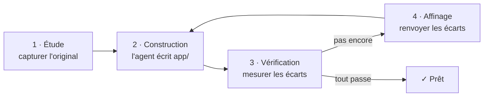

# craftkit

**Recréez n'importe quel logiciel avec l'agent de code que vous utilisez déjà, et prouvez que le
résultat est juste.**

[](https://www.npmjs.com/package/craftkit-cli)
[](https://pypi.org/project/craftkit/)


[English](https://github.com/lix033/craft-kit/blob/HEAD/README.md)

`craft` est un outil gratuit en ligne de commande. Donnez-lui un site web, un programme en ligne de
commande ou une application (ou décrivez simplement ce que vous voulez) : il fait construire votre
propre version par votre agent de code (Claude Code, Codex ou Gemini CLI). Ensuite, il **compare le
résultat à l'original avec de vraies mesures** et renvoie les différences à l'agent jusqu'à ce que
toutes les vérifications passent.

```sh
npm install -g craftkit-cli        # ou : pipx install craftkit
craft new https://exemple.com "recrée cette page en React"
cd recree-cette-page-en-react && craft run
```

---

## Pourquoi craft ?

Les agents de code écrivent vite, mais seuls, ils ne savent pas **quand ils ont fini**. Demandez
« un site comme celui-ci » : vous obtenez quelque chose qui *a l'air* terminé, puis vous passez
l'après-midi à comparer des captures d'écran et à recopier les différences à la main.

`craft` fait cette boucle à votre place :

| Sans craft | Avec craft |
|------------|------------|
| Vous décrivez l'original avec des mots | `craft` le capture : captures d'écran à 3 largeurs, polices et couleurs visibles, ce qu'un programme affiche |
| L'agent décide seul que c'est « fini » | C'est fini quand **des vérifications mesurées passent** : ça compile, ça ressemble, ça affiche pareil, les tests passent |
| Vous comparez à l'œil et recopiez les remarques | Chaque différence repart automatiquement vers l'agent, dans un budget fixé |
| Un long prompt, et on espère | Un dossier de projet avec les preuves, la tâche, chaque vérification et chaque tour, reprenable à tout moment |
| Lié à un seul outil | Marche avec Claude Code, Codex, Gemini CLI, ou n'importe quel assistant (par copier-coller) |

### À quoi ça sert

- **Recréer un site web** qui vous plaît comme point de départ : même mise en page sur ordinateur,
  tablette et téléphone, reconstruite de zéro dans votre technologie.
- **Réécrire un outil en ligne de commande** dans un autre langage, par exemple un script Python
  réécrit en Rust qui affiche la même chose pour les mêmes entrées.
- **Faire un jeu ou une application** à partir d'une description ou de vos propres captures, avec
  un auto-test qui prouve que la boucle de jeu fonctionne.
- **Construire un nouvel outil à partir d'une simple demande** (« un minuteur pomodoro en Go »),
  vérifié par des tests que l'agent doit écrire et faire passer.

## Comment ça marche



1. **Étude.** `craft` rassemble les preuves dans `capture/`. Pour un site : captures pleine page à
   1440, 768 et 390 px et faits visibles (titre, intertitres, polices, couleurs). Pour un programme :
   ce qu'il affiche pour quelques entrées, seulement si vous autorisez à le lancer. Les images que
   vous mettez dans `reference/` sont prises en compte.
2. **Construction.** Votre agent reçoit une tâche claire et travaille uniquement dans `app/`. Vous
   suivez en direct chaque fichier lu, chaque modification et chaque commande.
3. **Vérification.** Les mêmes vérifications à chaque tour : ça compile ? Ça ressemble à
   l'original à chaque largeur ? Ça affiche la même chose ? Les tests passent ?
4. **Affinage.** Ce qui échoue repart vers l'agent avec les écarts exacts. On recommence jusqu'à ce
   que tout passe, avec un budget de 6 affinages par demande. `craft` s'arrête aussi si l'agent ne
   change rien deux fois de suite.

Ce que vous voyez dans le terminal pendant le travail :

```text
 craft · pomodoro                                  cli · Rust · clean room
 ▍study  ./pomodoro ─────────────────────────────────────────────────
 ✓ runs    4 runs recorded
 ▍build  building · turn 1 ──────────────────────────────────────────
   0:03 ◇ read   BRIEF.md
   0:05 ☰ plan   2/5 · Writing the timer
   0:41 ✚ write  app/src/main.rs
   1:02 ❯ run    cargo build
   1:20 ✗ failed error[E0425]: cannot find value `paused`
   1:31 ✎ edit   app/src/main.rs
   └ 2m14s · 14 actions: 6 edit, 4 run, 3 read, 1 plan · 1 failed
 ✓ build   I built the timer with pause and resume.
 ▍check  round 1 ────────────────────────────────────────────────────
 ✗ runs    6 of 8 claims hold; output 71% alike.
   │ With --help, it prints what the original prints: 52% of the words match
 ▍refine  refining 1/6 · turn 2 ─────────────────────────────────────
   ⠼ refining 1/6 · claude · 0m48s · 3 · Edit app/src/main.rs
```

Chaque étape a sa couleur dans le terminal. L'interface de `craft` est en anglais.

---

## Installation

### Ce qu'il faut

| | Obligatoire ? | Pourquoi |
|---|---|---|
| **Python 3.9+** | oui | `craft` est écrit en Python, sans aucune dépendance |
| **Un agent de code** | oui | c'est lui qui écrit le code : [Claude Code, Codex ou Gemini CLI](#installer-un-agent-de-code) |
| **Node.js** | seulement pour `npm install` | npm est fourni avec Node.js ([nodejs.org](https://nodejs.org)) |
| **Un navigateur** | seulement pour les sites | pour les captures : Chrome/Edge installé suffit ; Playwright ajoute les mesures de style |

Python est déjà présent sur macOS et la plupart des Linux : vérifiez avec `python3 --version`. Sur
Windows, installez-le depuis [python.org](https://www.python.org/downloads/) ou avec
`winget install Python.Python.3.12`.

### Installer craft (au choix)

```sh
npm install -g craftkit-cli     # avec Node.js
pipx install craftkit           # avec pipx
uv tool install craftkit        # avec uv
```

Les trois installent le même programme et les mêmes commandes : `craft` (et les alias `craftkit`,
`craft-new`, `craft-run`).

Pour l'essayer sans rien installer : `npx craftkit-cli` ou `uvx craftkit`.

Vérifier que tout marche :

```sh
craft --version      # craft 0.3.3
craft agents         # les agents de code que craft trouve
```

### Installer un agent de code

`craft` n'écrit pas le code lui-même : c'est votre agent qui le fait. Installez-en au moins un,
puis **lancez-le une fois pour vous connecter** :

| Agent | Installer | Ensuite |
|-------|-----------|---------|
| **Claude Code** | `npm install -g @anthropic-ai/claude-code`<br/>ou `curl -fsSL https://claude.ai/install.sh \| bash` | lancer `claude` et se connecter |
| **Codex** | `npm install -g @openai/codex` | lancer `codex` et se connecter |
| **Gemini CLI** | `npm install -g @google/gemini-cli`<br/>ou `brew install gemini-cli` | lancer `gemini` et se connecter (offre gratuite avec un compte Google) |

Si aucun n'est installé, `craft` le dit tout de suite (écran d'accueil, `craft new`, et avant que
`craft run` ne démarre) et affiche ces commandes exactes.

**Pas d'agent du tout ?** `craft brief` affiche la tâche : collez-la dans n'importe quel assistant
de code (Cursor, Copilot…) ouvert dans le dossier du projet, puis lancez `craft check`.

### En option : de meilleures captures de sites

```sh
pip install playwright && playwright install chromium
```

Sans cela, `craft` utilise Chrome ou Edge installé (sans fenêtre), sinon Playwright via `npx`.

### Mettre à jour et désinstaller

| Installé avec | Mettre à jour | Désinstaller |
|---------------|---------------|--------------|
| npm | `npm update -g craftkit-cli` | `npm uninstall -g craftkit-cli` |
| pipx | `pipx upgrade craftkit` | `pipx uninstall craftkit` |
| uv | `uv tool upgrade craftkit` | `uv tool uninstall craftkit` |

La désinstallation ne touche pas à vos projets.

---

## Utilisation

### Le plus simple : l'écran d'accueil

Tapez **`craft`**. Vous voyez vos projets précédents et **+ New project**, qui pose quelques
questions et crée le projet dans `~/craft-projects`.

| Touche | Action |
|--------|--------|
| ↑ ↓ (ou j k) | se déplacer |
| Entrée | ouvrir un projet : continuer, demander un changement, ouvrir le résultat, revérifier, voir le dossier |
| n | nouveau projet |
| x | retirer de la liste (le dossier est conservé) |
| q / Échap | retour, ou quitter |

### En ligne de commande

```sh
craft new https://exemple.com "recrée ce site en React"   # crée ./recree-ce-site-en-react/
cd recree-ce-site-en-react
craft run                              # toute la boucle : étude → construction → vérification → affinage
craft run "l'en-tête doit rester fixe" # demander un changement (nouveau budget d'affinage)
craft open                             # ouvrir le résultat (sert le site, ou lance l'appli)
```

D'autres exemples :

```sh
craft new "un minuteur pomodoro en ligne de commande en Go"   # sans original : depuis la demande
craft new ./mon-outil "le même outil en Rust" --allow-run      # enregistre ce qu'il affiche, puis l'égale
craft new "un jeu snake en Python" --kind game

craft new "une appli de tâches en Electron"                   # depuis vos propres maquettes :
cp ~/Images/maquettes/*.png une-appli-de-taches-en-electron/reference/   # mettez-les dans reference/
cd une-appli-de-taches-en-electron && craft run
```

### Toutes les commandes

| Commande | Rôle |
|----------|------|
| `craft` | écran d'accueil : projets précédents, nouveau projet |
| `craft new [CIBLE] [DEMANDE…]` | créer un projet. CIBLE = adresse web, fichier, dossier, commande, ou rien |
| `craft run [MESSAGE…]` | toute la boucle ; avec un message, un changement à apporter |
| `craft study` · `build` · `check` | une étape à la fois |
| `craft status` | où en est le projet |
| `craft answer` | répondre aux questions de l'agent |
| `craft open` | ouvrir le résultat |
| `craft agents` | les agents de code installés, et comment en installer un |
| `craft brief` | afficher la tâche de l'agent, à coller dans n'importe quel assistant |
| `craft skill [--install DOSSIER]` | afficher ou installer le SKILL.md (voir plus bas) |

Options de `craft new` :

| Option | Signification |
|--------|---------------|
| `--kind website\|cli\|app\|game\|tool` | ce que vous fabriquez (sinon deviné d'après vos mots) |
| `--stack rust\|python\|react\|html\|go\|…` | le langage ou le framework (sinon deviné d'après vos mots) |
| `--allow-run` | autoriser à lancer le programme d'origine pour enregistrer ce qu'il affiche |
| `--deep` | autoriser à regarder à l'intérieur de l'original (voir [Clean room et Deep](#clean-room-et-deep)) |
| `--dir DOSSIER` | où créer le projet |

Option de `craft run` et `craft build` : `--agent claude|codex|gemini`.

### Ce qui est vérifié

| Vous fabriquez | Vérifications |
|----------------|---------------|
| un site (website) | ça compile · ça ressemble à l'original à 1440, 768 et 390 px · les tests passent |
| un outil en ligne de commande (cli) | ça compile · même code de sortie et au moins 80 % des mêmes mots pour chaque entrée enregistrée · tests |
| une application (app) | ça compile · elle démarre et dessine sa fenêtre (`--screenshot`) · tests |
| un jeu (game) | ça compile · un auto-test joue la boucle de jeu (`--self-test`) · une capture |
| une librairie ou un service (tool) | ça compile · des tests prouvent chaque fonction demandée |

Un tour est réussi quand aucune vérification n'échoue et que chaque score atteint 90 %.

### Le dossier du projet

```text
mon-projet/
  craft.json       la demande, la cible, le type, la technologie, le mode et les compteurs
  BRIEF.md         la tâche telle que donnée à l'agent
  capture/         les preuves de l'étude (lecture seule pour l'agent)
  reference/       vos images ou fichiers (lecture seule pour l'agent)
  app/             la construction : le seul dossier que l'agent modifie
  checks/          chaque tour de vérification et chaque tour de l'agent, avec les journaux
  unknowns.md      les questions encore ouvertes sur l'original
  questions.json   les questions de l'agent, avec vos réponses
```

Tout est en fichiers simples : vous pouvez arrêter à tout moment (Ctrl-C), fermer le terminal et
reprendre plus tard avec `craft run`.

---

## Clean room et Deep

Par défaut, `craft` travaille en **clean room** : il n'utilise que ce qu'un visiteur ou un
utilisateur peut voir (captures, texte visible, ce qu'un programme affiche). Il n'ouvre jamais le
code, les fichiers ou les sources de l'original.

Avec `--deep`, l'agent peut aussi regarder à l'intérieur (le HTML d'une page, les fichiers d'un
dossier, les chaînes d'un programme). À réserver à vos propres logiciels ou à un usage privé.

**Utilisez-le de façon responsable.** Recréer quelque chose pour apprendre ou pour démarrer, oui ;
publier la marque, les logos, les images ou les textes de quelqu'un d'autre, non. La tâche demande à
l'agent d'utiliser des contenus neutres et de ne jamais copier le code ou les ressources de
l'original. Respectez les droits d'auteur et les conditions d'utilisation des sites et programmes
étudiés.

## L'utiliser comme skill (Claude Code et autres agents)

La méthode de `craft` existe aussi sous forme de skill autonome, que n'importe quel agent peut
suivre, avec ou sans la CLI :

```sh
craft skill --install ~/.claude/skills    # Claude Code, pour tous les projets
craft skill > SKILL.md                    # ou l'afficher pour un autre agent
```

Demandez ensuite à votre agent : *« recrée exemple.com en React »*. Il suit les mêmes étapes
étude → construction → vérification → affinage.

## Configuration

Variables d'environnement :

| Variable | Effet |
|----------|-------|
| `CRAFT_AGENT=codex` | l'agent à utiliser (par défaut : le premier installé parmi claude, codex, gemini) |
| `CRAFT_PROJECTS_DIR` | où l'écran d'accueil crée les projets (par défaut `~/craft-projects`) |
| `CRAFT_FEED=0` | masquer le fil d'actions en direct, garder seulement la ligne de progression |
| `NO_COLOR=1` | pas de couleurs |
| `CRAFT_TURN_TIMEOUT` / `CRAFT_IDLE_TIMEOUT` | secondes par tour d'agent (3 h) / sans aucune sortie (20 min) |
| `CRAFT_BROWSER=python\|chrome\|npx\|none` | comment prendre les captures |
| `CRAFT_CHROME` | chemin vers Chrome ou Edge |
| `CRAFT_PYTHON` | (installation npm seulement) le Python à utiliser |

**Ajouter ou modifier un agent** dans `~/.config/craft/agents.json`. N'importe quel agent en ligne
de commande qui lit sa tâche sur l'entrée standard convient :

```json
{"mon-agent": {"argv": ["mon-agent", "--non-interactive"], "stream": "text"}}
```

Claude Code est lancé avec `--permission-mode acceptEdits` et une liste fixe d'outils autorisés
(modifications de fichiers, npm, cargo, go, python, make…). Les permissions ne sont jamais
contournées.

---

## Dépannage

**« No coding agent found »** : installez un des [agents ci-dessus](#installer-un-agent-de-code),
connectez-vous une fois, puis vérifiez avec `craft agents`.

**« craft needs Python 3.9 or newer »** (installation npm) : installez Python (voir
[Ce qu'il faut](#ce-quil-faut)), ou indiquez-en un avec `CRAFT_PYTHON=/chemin/vers/python3`.

**`craft: command not found` après l'installation** :
- npm : le dossier global de npm n'est pas dans votre PATH. `npm prefix -g` l'affiche ; ajoutez
  son sous-dossier `bin` au PATH. Ou utilisez `npx craftkit-cli`.
- pipx : lancez `pipx ensurepath`, puis ouvrez un nouveau terminal.

**L'agent s'arrête et demande de se connecter** : lancez l'agent seul une fois (`claude`, `codex`
ou `gemini`), connectez-vous, puis `craft run` reprend là où il s'était arrêté.

**Pas de captures pour un site** : installez Chrome, ou
`pip install playwright && playwright install chromium`.

**Arrêté en cours de route ?** Rien n'est perdu : `craft run` reprend depuis le dossier du projet.

## Limites

- La comparaison visuelle se fait sur une grille de couleurs : elle repère les écarts de mise en
  page et de couleur, pas les détails fins.
- Avec Chrome sans fenêtre, les captures font 2400 px de haut, pas la page entière ; les mesures de
  style visibles demandent Playwright pour Python.
- Les adaptateurs Codex et Gemini n'ont pas encore été essayés avec les vrais outils. Testé sur
  macOS ; Linux et Windows ne sont pas encore testés.

## Crédits et licence

`craft` condense la méthode étude → construction → vérification → affinage de
[Craft Anything](https://github.com/storytold/craft-anything) en un petit outil de terminal, sans
dépendance.

Libre et gratuit, au choix sous licence [MIT](https://github.com/lix033/craft-kit/blob/HEAD/LICENSE-MIT) ou [Apache 2.0](https://github.com/lix033/craft-kit/blob/HEAD/LICENSE-APACHE).
