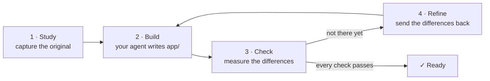

# craftkit

**Rebuild any software with the coding agent you already use, and prove the result is right.**

[](https://www.npmjs.com/package/craftkit-cli)
[](https://pypi.org/project/craftkit/)


[Français](https://github.com/lix033/craft-kit/blob/HEAD/README.fr.md)

`craft` is a free command-line tool. Point it at a website, a command-line program or an app (or
just describe what you want), and it has your coding agent (Claude Code, Codex or Gemini CLI) build
your own version. It then **checks the result against the original with real measurements** and
sends the differences back to the agent until every check passes.

```sh
npm install -g craftkit-cli        # or: pipx install craftkit
craft new https://example.com "recreate this landing page in React"
cd recreate-this-landing-page-in-react && craft run
```

---

## Why craft?

Coding agents write code fast, but on their own they don't know **when they're done**. Ask one to
"make a site like this one" and you get something that *looks* finished. You then spend the
afternoon comparing screenshots and pasting differences back by hand.

`craft` does that loop for you:

| Without craft | With craft |
|---------------|------------|
| You describe the original in words | `craft` captures it: screenshots at 3 screen widths, visible fonts and colours, what a program prints |
| The agent decides when it's "done" | The work is done when **measured checks pass**: it builds, it looks the same, it prints the same, its tests pass |
| You compare by eye and paste feedback | Each difference goes back to the agent automatically, up to a set budget |
| A long prompt, then you hope | A project folder with evidence, the brief, every check and every turn on disk, ready to resume anytime |
| Locked to one tool | Works with Claude Code, Codex, Gemini CLI, or any assistant (copy-paste mode) |

### What people use it for

- **Recreate a website** you like as a starting point: same layout on desktop, tablet and phone,
  built from scratch in your stack.
- **Rebuild a command-line tool** in another language, for example a Python script rewritten in
  Rust that prints the same output for the same inputs.
- **Make a game or desktop app** from a description or from your own screenshots, with a
  self-test that proves the core loop works.
- **Build a new tool from a plain request** ("a pomodoro timer CLI in Go"), verified by tests the
  agent must write and pass.

## How it works



1. **Study.** `craft` gathers evidence into `capture/`. For a website, it takes full-page
   screenshots at 1440, 768 and 390 px and records visible facts (title, headings, fonts,
   colours). For a program, it records what it prints for a few inputs (only if you allow running
   it). Pictures you add to `reference/` are included.
2. **Build.** Your coding agent receives a clear brief and works only inside `app/`. You watch
   it live: every file read, edit and command appears as it happens.
3. **Check.** The same checks run every round: does it build? Does it look like the original at
   each width? Does it print the same thing? Do its tests pass?
4. **Refine.** Anything that fails goes back to the agent with the exact differences. This repeats
   until every check passes, with a budget of 6 refinements per request. It also stops if the
   agent changes nothing twice in a row.

What you see in your terminal while it works:

```text
 craft · pomodoro                                  cli · Rust · clean room
 ▍study  ./pomodoro ─────────────────────────────────────────────────
 ✓ runs    4 runs recorded
 ▍build  building · turn 1 ──────────────────────────────────────────
   0:03 ◇ read   BRIEF.md
   0:05 ☰ plan   2/5 · Writing the timer
   0:41 ✚ write  app/src/main.rs
   1:02 ❯ run    cargo build
   1:20 ✗ failed error[E0425]: cannot find value `paused`
   1:31 ✎ edit   app/src/main.rs
   └ 2m14s · 14 actions: 6 edit, 4 run, 3 read, 1 plan · 1 failed
 ✓ build   I built the timer with pause and resume.
 ▍check  round 1 ────────────────────────────────────────────────────
 ✗ runs    6 of 8 claims hold; output 71% alike.
   │ With --help, it prints what the original prints: 52% of the words match
 ▍refine  refining 1/6 · turn 2 ─────────────────────────────────────
   ⠼ refining 1/6 · claude · 0m48s · 3 · Edit app/src/main.rs
```

Each stage has its own colour in the terminal.

---

## Installation

### What you need

| | Required? | Why |
|---|---|---|
| **Python 3.9+** | yes | `craft` is written in Python, with no dependencies |
| **A coding agent** | yes | it writes the code: [Claude Code, Codex or Gemini CLI](#install-a-coding-agent) |
| **Node.js** | only for `npm install` | npm comes with Node.js ([nodejs.org](https://nodejs.org)) |
| **A browser** | only for websites | for screenshots: installed Chrome/Edge works; Playwright adds visible-style measurements |

Python is already installed on macOS and most Linux systems; check with `python3 --version`. On
Windows, install it from [python.org](https://www.python.org/downloads/) or with
`winget install Python.Python.3.12`.

### Install craft (pick one)

```sh
npm install -g craftkit-cli     # with Node.js
pipx install craftkit           # with pipx
uv tool install craftkit        # with uv
```

All three install the same program and the same commands: `craft` (plus the aliases `craftkit`,
`craft-new`, `craft-run`).

To try it without installing anything: `npx craftkit-cli` or `uvx craftkit`.

Check that it works:

```sh
craft --version      # craft 0.3.3
craft agents         # shows which coding agents craft can find
```

### Install a coding agent

`craft` doesn't write code itself; your coding agent does. Install at least one, then **run it
once to sign in**:

| Agent | Install | Then |
|-------|---------|------|
| **Claude Code** | `npm install -g @anthropic-ai/claude-code`<br/>or `curl -fsSL https://claude.ai/install.sh \| bash` | run `claude` and sign in |
| **Codex** | `npm install -g @openai/codex` | run `codex` and sign in |
| **Gemini CLI** | `npm install -g @google/gemini-cli`<br/>or `brew install gemini-cli` | run `gemini` and sign in (free tier with a Google account) |

If none is installed, `craft` says so right away (on the home screen, at `craft new` and before
`craft run` starts) and prints these exact commands.

**No agent at all?** `craft brief` prints the task. Paste it into any coding assistant (Cursor,
Copilot, …) opened in the project folder, then run `craft check`.

### Optional: better website screenshots

```sh
pip install playwright && playwright install chromium
```

Without it, `craft` uses an installed Chrome or Edge in headless mode, and otherwise falls back to
Playwright through `npx`.

### Update and uninstall

| Installed with | Update | Uninstall |
|----------------|--------|-----------|
| npm | `npm update -g craftkit-cli` | `npm uninstall -g craftkit-cli` |
| pipx | `pipx upgrade craftkit` | `pipx uninstall craftkit` |
| uv | `uv tool upgrade craftkit` | `uv tool uninstall craftkit` |

Uninstalling leaves your projects alone.

---

## Usage

### The easy way: the home screen

Type **`craft`**. You get your past projects and a **+ New project** entry, which asks a few
questions and creates the project in `~/craft-projects`.

| Key | Action |
|-----|--------|
| ↑ ↓ (or j k) | move |
| Enter | open a project: continue, ask for a change, open the result, re-check, show the folder |
| n | new project |
| x | remove from the list (the folder is kept) |
| q / Esc | back, or quit |

### From the command line

```sh
craft new https://example.com "recreate this site in React"   # creates ./recreate-this-site-in-react/
cd recreate-this-site-in-react
craft run                              # the whole loop: study → build → check → refine
craft run "make the header sticky"     # ask for a change (starts a new refinement budget)
craft open                             # open the result (serves a site, or runs the app)
```

More examples:

```sh
craft new "a pomodoro timer CLI in Go"                # no original: build from the request
craft new ./my-tool "the same tool in Rust" --allow-run   # record what it prints, then match it
craft new "a snake game in Python" --kind game

craft new "a todo app in Electron"                    # from your own mockups:
cp ~/Pictures/mockups/*.png a-todo-app-in-electron/reference/   # put them in reference/
cd a-todo-app-in-electron && craft run
```

### All commands

| Command | What it does |
|---------|--------------|
| `craft` | home screen: past projects, new project |
| `craft new [TARGET] [REQUEST…]` | create a project. TARGET is a web address, a file, a folder, a command, or nothing |
| `craft run [MESSAGE…]` | the whole loop; with a message, a change to the build |
| `craft study` · `build` · `check` | one step at a time |
| `craft status` | where the project is |
| `craft answer` | answer the agent's questions |
| `craft open` | open the result |
| `craft agents` | which coding agents are installed, and how to get one |
| `craft brief` | print the agent's task, to paste into any assistant |
| `craft skill [--install DIR]` | print or install the SKILL.md (see below) |

Options for `craft new`:

| Option | Meaning |
|--------|---------|
| `--kind website\|cli\|app\|game\|tool` | what you're making (guessed from your words otherwise) |
| `--stack rust\|python\|react\|html\|go\|…` | the language or framework (guessed from your words otherwise) |
| `--allow-run` | allow running the original program to record what it prints |
| `--deep` | allow looking inside the original (see [Clean room and Deep](#clean-room-and-deep)) |
| `--dir DIR` | where to create the project |

Options for `craft run` and `craft build`: `--agent claude|codex|gemini`.

### What gets checked

| You're making | Checks |
|---------------|--------|
| website | it builds · it looks like the original at 1440, 768 and 390 px · its tests pass |
| cli | it builds · same exit code and ≥ 80% of the same words for each recorded input · tests |
| app | it builds · it starts and draws a window (`--screenshot`) · tests |
| game | it builds · a scripted self-test plays the core loop (`--self-test`) · a screenshot |
| tool / library | it builds · tests that prove each feature you asked for |

A round passes when no check fails and every score reaches 90%.

### The project folder

```text
my-project/
  craft.json       the request, target, kind, stack, mode and counters
  BRIEF.md         the task as given to the agent
  capture/         evidence from Study (read-only for the agent)
  reference/       your own pictures or files (read-only for the agent)
  app/             the build: the only folder the agent changes
  checks/          every check round and every agent turn, with logs
  unknowns.md      open questions about the original
  questions.json   the agent's questions, with your answers
```

Everything is plain files, so you can stop at any time (Ctrl-C), close the terminal and carry on
later with `craft run`.

---

## Clean room and Deep

By default `craft` works in **clean room** mode: it uses only what a visitor or user can see
(screenshots, visible text, what a program prints). It never opens the original's source, files or
code.

With `--deep`, the agent may also look inside the original (a page's HTML, a folder's files, a
program's strings). Use it for your own software or private study.

**Use it responsibly.** Rebuilding something for learning or as a starting point is fine; shipping
someone else's brand, logos, images or text is not. The brief tells the agent to use neutral
placeholders and never to copy the original's code or assets. Respect copyrights and the terms of
the sites and programs you study.

## Use it as a skill (Claude Code and other agents)

The method behind `craft` is also written as a standalone skill that any agent can follow, with or
without the CLI:

```sh
craft skill --install ~/.claude/skills    # Claude Code, all projects
craft skill > SKILL.md                    # or print it for another agent
```

Then ask your agent: *"recreate example.com in React"*, and it follows the same
study → build → check → refine steps.

## Configuration

Environment variables:

| Variable | Effect |
|----------|--------|
| `CRAFT_AGENT=codex` | the agent to use (default: the first installed of claude, codex, gemini) |
| `CRAFT_PROJECTS_DIR` | where the home screen creates projects (default `~/craft-projects`) |
| `CRAFT_FEED=0` | hide the live action feed and keep only the progress line |
| `NO_COLOR=1` | no colours |
| `CRAFT_TURN_TIMEOUT` / `CRAFT_IDLE_TIMEOUT` | seconds per agent turn (3 h) / without output (20 min) |
| `CRAFT_BROWSER=python\|chrome\|npx\|none` | how screenshots are taken |
| `CRAFT_CHROME` | path to Chrome or Edge |
| `CRAFT_PYTHON` | (npm install only) the Python to use |

**Add or change an agent** in `~/.config/craft/agents.json`. Any command-line agent that reads its
task from standard input works:

```json
{"my-agent": {"argv": ["my-agent", "--non-interactive"], "stream": "text"}}
```

Claude Code runs with `--permission-mode acceptEdits` and a fixed list of allowed tools (file
edits, npm, cargo, go, python, make…). Permissions are never bypassed.

---

## Troubleshooting

**"No coding agent found"**: install one of the [agents above](#install-a-coding-agent), sign in
once, then run `craft agents` to confirm it's found.

**"craft needs Python 3.9 or newer"** (npm install): install Python (see
[What you need](#what-you-need)), or point to one with `CRAFT_PYTHON=/path/to/python3`.

**`craft: command not found` after installing**:
- npm: your npm global folder isn't on your PATH. `npm prefix -g` shows it; add its `bin` folder
  to PATH. Or use `npx craftkit-cli`.
- pipx: run `pipx ensurepath`, then open a new terminal.

**The agent stops and asks to sign in**: run the agent once by itself (`claude`, `codex` or
`gemini`), sign in, then `craft run` carries on where it stopped.

**No screenshots for a website**: install Chrome, or `pip install playwright && playwright install
chromium`.

**Stopped half-way?** Nothing is lost: `craft run` resumes from the project folder.

## Limitations

- Visual comparison works on a colour grid. It catches layout and colour differences, not fine
  details.
- With headless Chrome, screenshots are 2400 px tall rather than the full page; visible-style
  measurements need Playwright for Python.
- The Codex and Gemini adapters haven't been tested against the real tools yet. Tested on macOS;
  Linux and Windows aren't tested yet.

## Credits and license

`craft` distils the study → build → check → refine method of
[Craft Anything](https://github.com/storytold/craft-anything) into a small terminal tool with no
dependencies.

Free and open source, under your choice of the [MIT](https://github.com/lix033/craft-kit/blob/HEAD/LICENSE-MIT) or
[Apache 2.0](https://github.com/lix033/craft-kit/blob/HEAD/LICENSE-APACHE) license.
